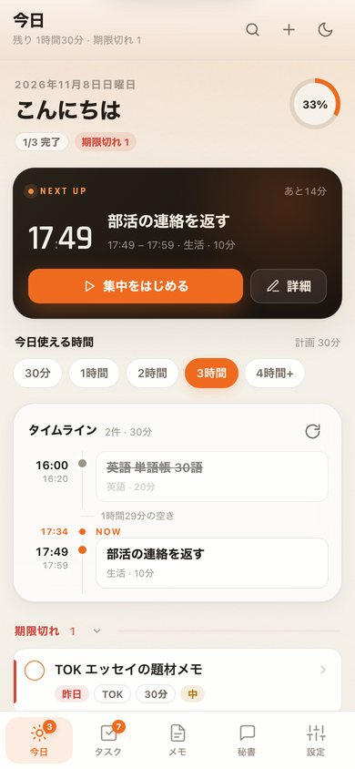
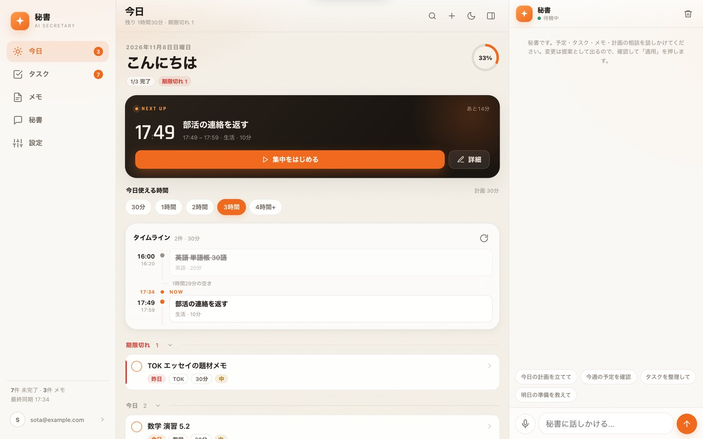

# AI秘書アプリ

仕様は `AI秘書アプリ 仕様書 v1.txt` を参照(仕様確定済み)。

自分専用のAI秘書PWA。**今日の計画・タスク・メモ・課題(ManageBac)・相談**を、ひとつの画面で扱う。
v2 でUI/UXと機能を全面的に刷新した(単一HTMLから、デザインシステム + モジュール構成へ)。

| iPhone | Mac |
|---|---|
|  |  |

※ 画像はモックデータのプレビュー(`?preview=1`)。

## v2 の変更点

### UI / UX

- **デザインシステム** — ボーンホワイト + オレンジ + liquid glass を再構築。余白・字組み・影・モーションのトークン化
- **ライト / ダーク / 自動**、アクセント4色(オレンジ・アンバー・セージ・ブルー)、リスト密度の切替。端末ごとに保存
- **今日ビュー** — 「NEXT UP」カード(開始時刻・残り時間・集中ボタン)、進捗リング、タイムライン、期限切れ/今日/期限なし/今後7日/完了の折りたたみグループ
- **タイムライン** — NOWライン、空き時間の表示、終了時刻、進行中ハイライト
- **集中モード** — 全画面タイマー。一時停止・+5分・終了時に実績時間を `actual_min` へ記録し、そのまま完了にできる。Wake Lock対応
- **コマンドパレット** — `⌘K` / `Ctrl+K` / `/`。タスク・メモの横断検索、各画面への移動、新規作成、計画の組み直し、テーマ切替などをキーボードだけで実行
- **自然言語クイック追加** — `明日15時 化学レポート #化学 45分` のように書くだけで、期限・見積り・カテゴリ・優先度を解釈。入力中に解釈結果をプレビュー
- **編集シート** — モバイルはボトムシート、デスクトップはダイアログ。優先度・実績・AI非公開フラグを編集
- **チャット** — マークダウン表示、コピー/読み上げ、構造化された提案カード、複数提案の一括適用、適用後の「元に戻す」
- **レスポンシブ** — iPhone: 1画面 + 下タブ / iPad: アイコンレール + 2ペイン / Mac: サイドバー + 2ペイン(チャット開閉)
- 空状態・スケルトン・オフラインバナー・トースト(元に戻す)を統一

### 機能

- **空き時間キャパシティ** — その日の使える時間(30分〜4時間+)を選ぶと、その枠に合わせて自動計画を組み直す
- **見積り学習** — 集中モードで記録した実績から、カテゴリ別の「見積り÷実績」補正値を計算し、次回の自動計画に反映。設定画面に補正値を表示
- **週の振り返り** — 直近7日の完了数・集中時間・新規追加・期限切れと、曜日別のバーを表示
- **オフライン閲覧** — 直近の同期結果をローカルにキャッシュ。通信できないときはキャッシュを表示
- **PWA** — `manifest.webmanifest` / Service Worker / アイコン。ホーム画面に追加でき、アプリシェルはオフラインでも起動する
- **今日ビューに今後7日** — 未来の課題(ManageBac含む)を見落とさない

## 構成

| パス | 内容 |
|---|---|
| `app/index_1.html` | PWAのシェル(マークアップ)。GitHub Pagesでは `index.html` として公開 |
| `app/app.css` | デザインシステム(トークン、レイアウト、コンポーネント、ロック画面) |
| `app/app.js` | アプリ本体(認証、データ、自動計画、集中モード、チャット、設定、PWA) |
| `app/mock.js` | ローカル確認用のSupabaseモック。`?preview=1` のときだけ読み込まれる(本番では未使用) |
| `app/manifest.webmanifest` / `app/sw.js` / `app/icons/` | PWA(インストール・オフライン) |
| `.github/workflows/pages.yml` | `app/` をGitHub Pagesへデプロイ(`index_1.html`→トップページ) |
| `supabase/schema.sql` | `sec_*` テーブル + 共有 `managebac_*` テーブルのスキーマ(RLS付き)。SQL Editorで実行 |
| `supabase/functions/ai/` | AIルーター Edge Function。Gemini → NIM → Hermes(チャット/計画)、NIM → Gemini(課題ヒント)。承認制propose_*ツール + `sec_ai_log` 記録付き |
| `managebac auto/` | ManageBac 非公式スクレイパー + Supabase同期 |
| `.github/workflows/managebac-sync.yml` | 数時間おきの自動取り込み(GitHub Actions) |

## ローカルで見る

UIだけを確認したいときは、Supabaseにログインせずにモックデータで開ける。

```
cd AI_secretary
python3 -m http.server 8765
# → http://127.0.0.1:8765/app/index_1.html?preview=1
```

- `?preview=1` は **localhost / 127.0.0.1 のときだけ**有効。本番URLでは通常どおりログイン画面になる
- モックのタスク・メモ・ManageBac課題・AI応答(提案カード付き)が入っている
- `app/index.html` は廃止した(ビルド時に `index_1.html` から生成される)
- Service Worker のキャッシュは `app/sw.js` の `VERSION` で管理している。フロントを更新したら
  この値を上げる(古いアプリシェルが残るのを防ぐ)。SWは https / localhost でのみ登録される

## セットアップ

1. Supabase プロジェクトを作成し、`supabase/schema.sql` → `supabase/phase2.sql` の順に SQL Editor で実行
   (既存DBがある場合も phase2.sql は冪等なので安全に再実行できる)
2. 自分のアカウントを作成したら **新規登録をOFF** にする(仕様書 §3)
3. PWAをデプロイ: リポジトリの Settings → Pages → Source を **GitHub Actions** にする。
   以降 `main` への `app/` 変更pushで自動デプロイされる(手動はActionsの pages → Run workflow)
4. ManageBac 同期用に `.env` を作成(`.env.example` をコピー)してローカルで確認:
   ```
   cd "managebac auto"
   .venv/bin/python sync_to_supabase.py --dry-run   # 一覧スクレイプのみ確認
   .venv/bin/python sync_to_supabase.py             # 一覧+課題詳細を同期
   .venv/bin/python sync_to_supabase.py --no-detail # 一覧のみ(詳細ページを叩かない)
   .venv/bin/python managebac_client.py detail <class_id> <task_id>  # 詳細だけ確認
   ```
   課題の詳細ページ(説明文)は `managebac_tasks.detail` に保存される。
   未取得 or 24h以上経過のものだけを1回最大50件(`--detail-limit`)、1.2秒間隔で取得する
   (アカウントBAN回避)。`detail_fetched_at` で最終取得時刻を管理。
5. GitHub リポジトリを **private** にして、Actions Secrets に以下を登録:
   `MB_BASE_URL`, `MB_EMAIL`, `MB_PASSWORD`, `SUPABASE_URL`, `SUPABASE_SERVICE_ROLE_KEY`
   (サービスロールキーを使わない場合は `SUPABASE_ANON_KEY` + `SB_EMAIL` + `SB_PASSWORD`)
6. AIルーター Edge Function をデプロイし、Secretsを設定:
   ```
   supabase secrets set GEMINI_API_KEY=... NIM_API_KEY=...   # NIMはNVIDIA_API_KEYでも可
   # --no-verify-jwt: GET診断とgcalのOAuthコールバック(ブラウザ遷移でヘッダーが付かない)を通すため。
   # POSTは関数内で auth.getUser() によりユーザーJWTを検証するので実質同じ強度。
   supabase functions deploy ai --no-verify-jwt   # ← Secrets変更後は必ず再デプロイ
   supabase functions deploy gcal --no-verify-jwt
   supabase secrets list               # 設定確認
   ```
   **503 (Service Unavailable) が出る場合**はほぼ Secrets未設定 or 再デプロイ忘れ。
   Dashboard → Edge Functions → ai → Logs で実際のエラーを確認できる。
   ヘルス確認: `curl https://<ref>.supabase.co/functions/v1/ai` (anon key不要のGET) で
   `{providers:{gemini:bool, nim:bool}, models:{...}}` が返る。
   実際に使えるモデル一覧(anon keyヘッダー付き):
   `curl -H "apikey: <anon key>" -H "Authorization: Bearer <anon key>" "https://<ref>.supabase.co/functions/v1/ai?action=models"`
   (gemini_live / nim_live にプロバイダ側の最新一覧が返る)

   **モデル名について(2026-11時点)**: Geminiの `gemini-2.x` は退役済みで 404 になる。
   既定は `gemini-flash-latest,gemini-pro-latest`(latestエイリアスなので常に現行を指す)で、
   404/退役を検知したら自動で次の候補モデルにフォールバックする。
   NIMは `integrate.api.nvidia.com/v1/models` で現存確認済みの候補から順に試す。
   個別指定は Secrets で上書き可: `GEMINI_MODEL` / `GEMINI_MODELS`(カンマ区切り) /
   `NIM_MODEL` / `NIM_MODELS`(カンマ区切り)。
7. Googleカレンダー連携 (アプリ→カレンダーへの書き込み):
   - Google Cloud Console で OAuth クライアント(ID/シークレット)を作成し、
     承認済みリダイレクトURIに `https://<ref>.supabase.co/functions/v1/gcal?action=callback` を登録
   - `supabase secrets set GOOGLE_CLIENT_ID=... GOOGLE_CLIENT_SECRET=...`
   - `supabase functions deploy gcal --no-verify-jwt` (OAuthコールバックがヘッダー無しGETのため)
   - `supabase/schema.sql` → `phase2.sql` を再実行 (sec_gcal / gcal_event_id 列)
   - アプリの設定画面 → Googleカレンダー →「連携」→ 同意 →「同期」
   - `sec_gcal` はクライアントから不可視(RLSで拒否、状態は `sec_gcal_status` ビューのみ)
8. カレンダー購読(iCalフィード — OAuth不要、スクレイピング不要):
   - `supabase functions deploy ics --no-verify-jwt`(GETはトークン認証、POSTはユーザーJWT検証)
   - `schema.sql` → `phase2.sql` を再実行 (`sec_ics_tokens`)
   - アプリ設定画面の「カレンダー購読」カードに表示されるURLをコピー
   - Googleカレンダー → 他のカレンダー横の「+」→「URLから追加」→ URLを貼り付け
   - 反映はGoogle側の巡回間隔次第で数十分〜数時間遅れる(リアルタイム不要な用途向け。
     即時に書き込みたい場合は 7. のOAuth版 gcal を併用)

フロント(`app/app.js`)の `askServer()` が使う契約:
リクエスト `{message, history:[{role,content}], tz, now, purpose?}` →
レスポンス `{text, provider, tried:[{provider,ok}], proposals:[{tool,args}]}` または `{error}`。
`proposals[].tool` は `propose_add_task / propose_add_note / propose_update_item /
propose_complete_task / propose_delete_item / propose_memory / propose_schedule / propose_estimate` のいずれかで、
`args` はフロントの `applyProposal()` がそのまま消費する形。適用はユーザー承認後に
アプリ側がユーザー権限(PostgREST/RLS)で行う。

フロントの設定は `app/app.js` 冒頭の `SUPABASE_URL` / `SUPABASE_KEY` の2行だけ
(URLは設定済み、KEYは Settings → API の anon public key)。

ManageBacの自動取り込みは3時間おき。失敗時は `managebac_import_log` に `ok=false` が記録され、
アプリ側は同期時刻を表示する(仕様書 §6)。

## 使い方のヒント

- `⌘K` / `Ctrl+K`: 検索とコマンド。`/` でも開く
- `N`: 新規タスク。`⌘Enter` で保存
- 今日の「使える時間」チップ: 押すとその枠で計画を組み直す
- タスクの`集中をはじめる`: 終了時に実測時間が記録される(見積り学習に使われる)
- 自然言語: `明日15時 化学 #化学 45分`、`来週月曜 数学 1時間`、`週末 模試 3時間`
- 設定 → 外観: テーマ・アクセント・密度・モーション
- 設定 → ホーム画面に追加: 対応ブラウザでインストール

## ローカル検証

```
cd "managebac auto"
.venv/bin/python -m py_compile managebac_client.py sync_to_supabase.py todo.py
.venv/bin/python todo.py --days 7     # 要提出+直近の予定を表示
.venv/bin/python managebac_client.py serve   # http://127.0.0.1:8000/docs
```
